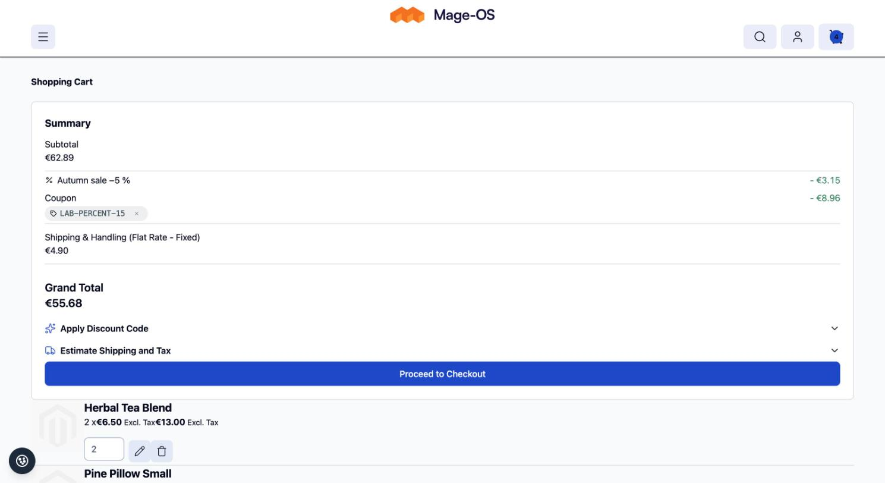
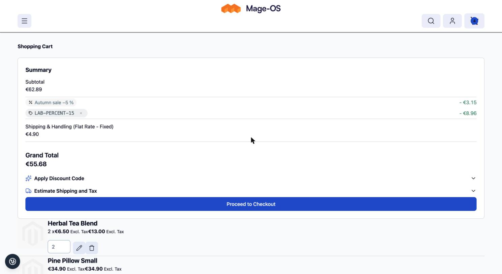
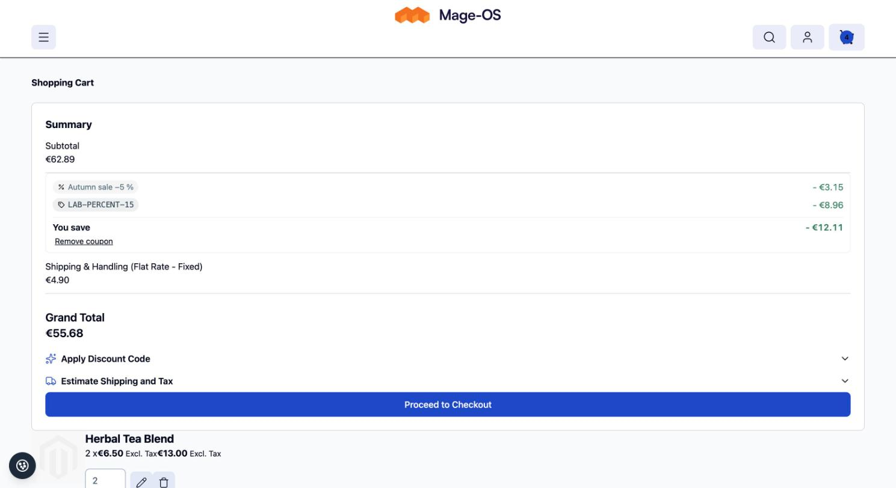
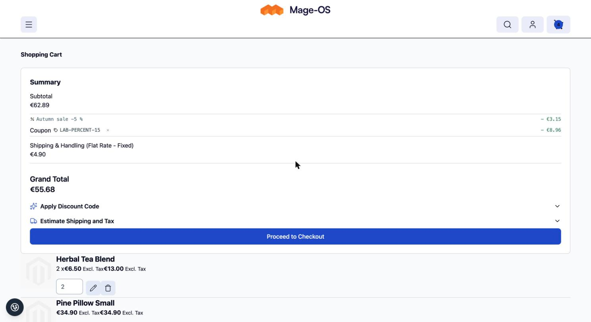
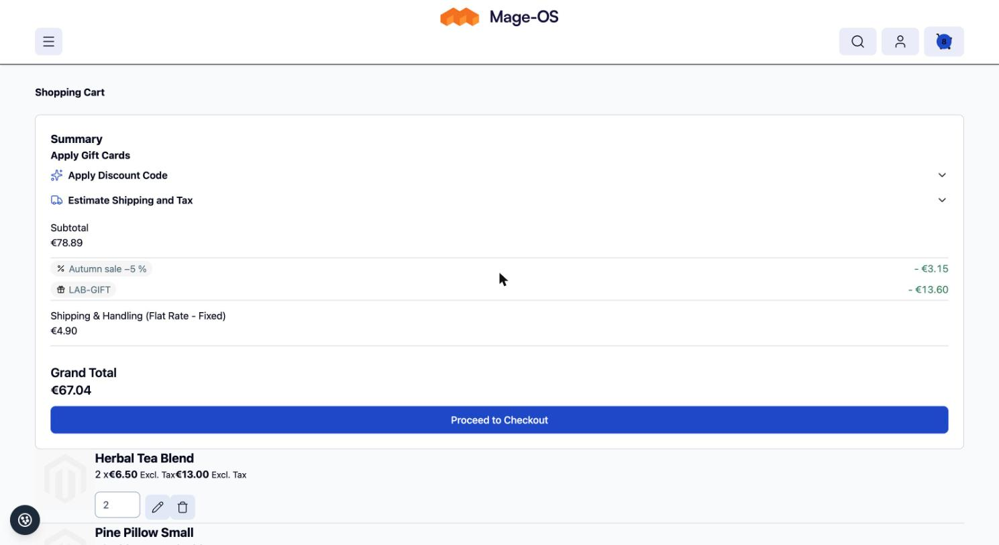
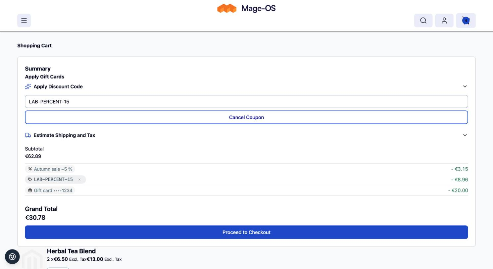

# Discount Lines for the Hyvä Default Theme

Renders one totals line per discount (coupon, automatic rule, gift, free shipping) on the cart page of the
[Hyvä default theme](https://github.com/hyva-themes/magento2-default-theme), using the data and display variant
(A to D) provided by
[`pixelperfectat/magento2-module-discount-lines`](https://github.com/pixelperfectat/magento2-module-discount-lines).

## Requirements

- `pixelperfectat/magento2-module-discount-lines`
- Hyvä default theme and Hyvä theme module (free, installed from Hyvä's own repository, not from Packagist)

## Installation

```bash
composer require pixelperfectat/magento2-module-discount-lines-hyva-theme
bin/magento setup:upgrade
```

## How it works

- Replaces the `discount` block (`Magento_Checkout::php-cart/totals/discount.phtml`, re-declared by the theme's `Magento_Tax` layout, so a plain template override would not win) with its own block on the
  `hyva_checkout_cart_index` page. The Hyvä cart totals are rendered client side with Alpine.js, so the lines are read from
  `segment.extension_attributes.discount_lines` of the totals data and update together with the totals. Without lines
  (module disabled, or a quote without stored lines) the original Hyvä markup (title and value) is rendered.
- The layout lives in the `hyva_checkout_cart_index` handle, which Hyvä's theme module only adds when a Hyvä theme is
  active, so other themes of the same install keep their own cart. Because the theme's `discount` block is removed
  and replaced, `referenceBlock name="discount"` customisations in your theme must target `pp.discount-lines` instead.
- The "You save" sum of variant C is calculated in the browser from the lines, rounded to cents, and formatted with
  `hyva.formatPrice`.
- Loads the base stylesheet `PixelPerfect_DiscountLines::css/discount-lines.css`. Colours come from the CSS custom
  properties `--pp-dl-chip-bg`, `--pp-dl-chip-ink`, `--pp-dl-auto-bg`, `--pp-dl-auto-ink` and `--pp-dl-save`;
  override them on `:root` in your theme.
- The remove button on a coupon chip posts the cart coupon form (`checkout/cart/couponPost` with `remove=1`) through
  `hyva.postCart`, so the cart page reloads its content like it does for the coupon form.

## Variants

Set under Stores > Configuration > Sales > Discount Lines: A (label with chip below), B (chip as the label, default),
C (grouped block with "You save" total), D (quiet icon and monospace).

## Configuration

Configured in the base package under Stores > Configuration > Sales > Discount Lines (store-view scope):
`pp_discount_lines/general/enabled` (default `1`) and `pp_discount_lines/display/variant` (`A` to `D`, default `B`).
See the [base README](https://github.com/pixelperfectat/magento2-module-discount-lines#configuration) for the full table.

## Contract

The data this package renders (`extension_attributes.discount_lines`, row data key `discount_line`, the label rule
and the line kinds) is described in the
[contract section of the base README](https://github.com/pixelperfectat/magento2-module-discount-lines#contract-with-the-sales-email-module).

## Known limits

- Orders placed before the base module was installed keep the merged core row.
- Existing carts show the core row until the next totals collect.
- The Hyvä theme `discount` block is replaced by this package's block `pp.discount-lines`; customisations of the
  original block (`referenceBlock name="discount"`) must target `pp.discount-lines` instead.
- Only active on Hyvä themes (layout handle `hyva_checkout_cart_index`); other themes keep their own cart.
- See the base README for the complete list of known limits.

## Screenshots

Placeholder data only, in `docs/screenshots/`:













## Development

```bash
composer install
composer check
```

## License

MIT, see `LICENSE`.
